<p align="center">
  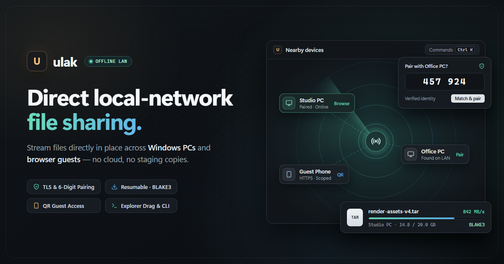
</p>

# Ulak

**Offline, zero-staging local-network file sharing for Windows PCs and browser guests.**

Ulak lets a Windows PC expose selected files and folders directly from their original location over an encrypted local network connection, without cloud relays, user accounts, internet access, or staging copies. Paired computers and temporary browser guests browse permitted shares and pull only the files they want.

[Highlights](#highlights) · [Visual Tour](#visual-tour) · [Keyboard Shortcuts](#keyboard-shortcuts) · [Architecture](#architecture) · [CLI Usage](#live-local-cli) · [Development](#development) · [Status & Guarantees](#limits-guarantees-and-status)

---

## Highlights

- **Files stay where they are**: Publishing registers a source reference under an opaque share ID. No copies are staged in app storage and no temporary ZIP archives are created.
- **Bounded-memory streaming**: Files stream directly from Windows source handles using 64 KiB I/O buffers, keeping transfer memory independent of file size.
- **Persistent cryptographic identity**: Devices are identified by persistent Ed25519 keys rather than IP addresses or hostnames. Switching between Wi-Fi and Ethernet or renewing a DHCP lease updates the verified endpoint without breaking pairing or share permissions.
- **Nearby numeric pairing**: Discover Ulak PCs on the local network via mDNS (`_ulak._tcp.local.`) and pair by confirming the same 6-digit comparison number on both screens, with no certificate strings to copy and paste. Single-use invitations remain available when multicast is unavailable.
- **Explicit share audiences**: Grant access per share to **Invitation only**, **Choose devices** (including currently offline paired PCs), or **Everyone on the local network** (read-only within configured allowed LAN ranges).
- **Resumable, BLAKE3-verified downloads**: Native transfers persist flushed byte offsets in `.part` files, validate HTTP byte ranges and source revisions on resume, verify complete-file BLAKE3 digests, and finalize without overwriting existing files.
- **Browser guest mode (no app install)**: Share a QR code or single-use link with phones, tablets, or other browsers over local HTTPS using a locally bundled, zero-external-request interface.
- **Windows Explorer integration**: Drag local files/folders into Ulak to share them, or prepare selected remote files for lazy range-backed virtual-file drag-out into Explorer.
- **Keyboard-first desktop + local CLI**: Summon from anywhere with `Ctrl+Alt+U`, jump across devices/shares/actions with `Ctrl+K`, or script shares and downloads with the `ulak` CLI over a current-user-only Windows named pipe.

---

## Visual Tour

### Desktop Overview

The compact desktop opens on **Devices**, showing persistently paired computers (both online and offline), live nearby discovery, quick access to your latest shares, an Explorer drop zone, and a persistent transfer status bar across views.

<p align="center">
  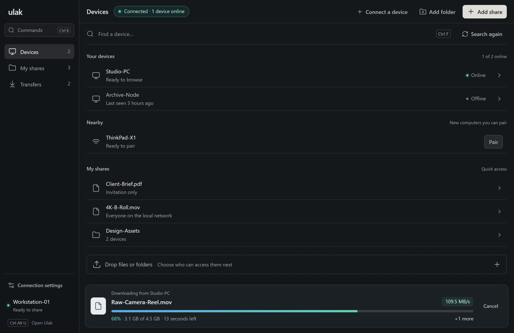
</p>

### 1. Discover Nearby PCs & Pair with a 6-Digit Number

Open **Devices** or **Connect a device**, pick your Wi-Fi or Ethernet network when sharing beyond loopback, and select a nearby Ulak computer from the radar or device list. Both sides run a commit-before-reveal signed exchange and display the same 6-digit number; confirm **Match and pair** on both computers to save trust. Pairing alone never exposes private files.

<table>
  <tr>
    <td width="50%">
      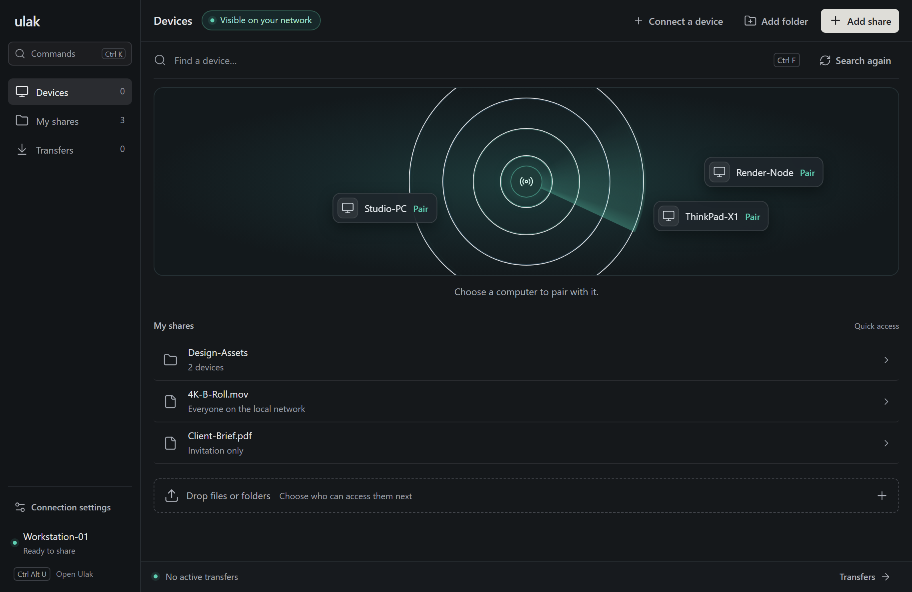
      <br /><sub><b>Nearby Radar</b>: Live mDNS discovery candidates appear around the radar stage for one-click pairing.</sub>
    </td>
    <td width="50%">
      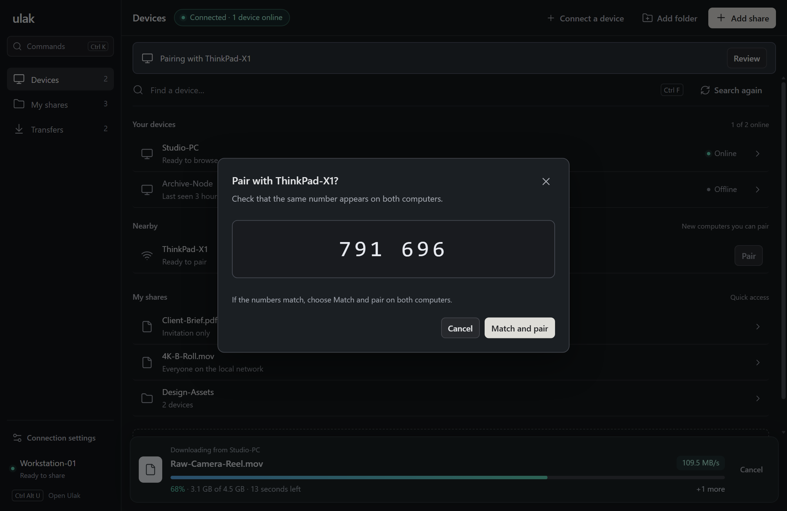
      <br /><sub><b>Numeric Comparison</b>: Both computers verify the transcript-bound 6-digit code before persisting trust.</sub>
    </td>
  </tr>
</table>

---

### 2. Share Folders & Control Exactly Who Can Access Them

Add files or folders with **Add share**, **Add folder**, or by dropping them from Windows Explorer. Every share carries its current audience on the row and in the collapsible detail panel. Offline paired PCs remain selectable in **Choose devices** and can pull permitted files whenever both computers are reachable again.

<table>
  <tr>
    <td width="50%">
      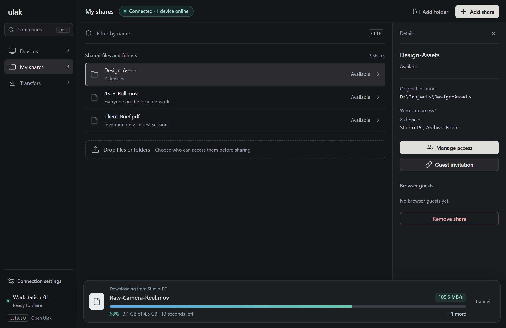
      <br /><sub><b>My Shares & Details</b>: Inspect original source paths, active audiences, and browser guest controls without leaving the list.</sub>
    </td>
    <td width="50%">
      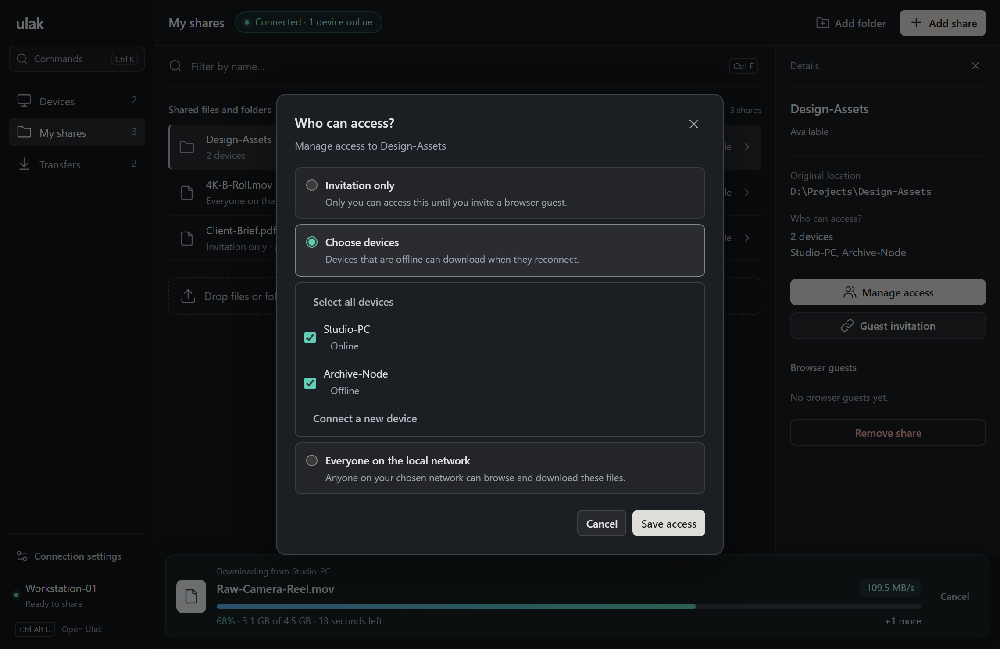
      <br /><sub><b>Explicit Audiences</b>: Restrict to invitations, pick specific online/offline paired devices, or open read-only access to the local network.</sub>
    </td>
  </tr>
</table>

---

### 3. Remote Browsing, Explorer Drag-Out & Verified Transfers

Click any online paired device (or browse LAN-open shares without pairing) to inspect paginated folders. Download whole folders via the native destination picker, queue up to four files per batch, or click **Get ready to drag** to expose lazy range-backed COM virtual-file streams for Windows Explorer. Active downloads stay visible in the persistent footer bar across every view.

<table>
  <tr>
    <td width="50%">
      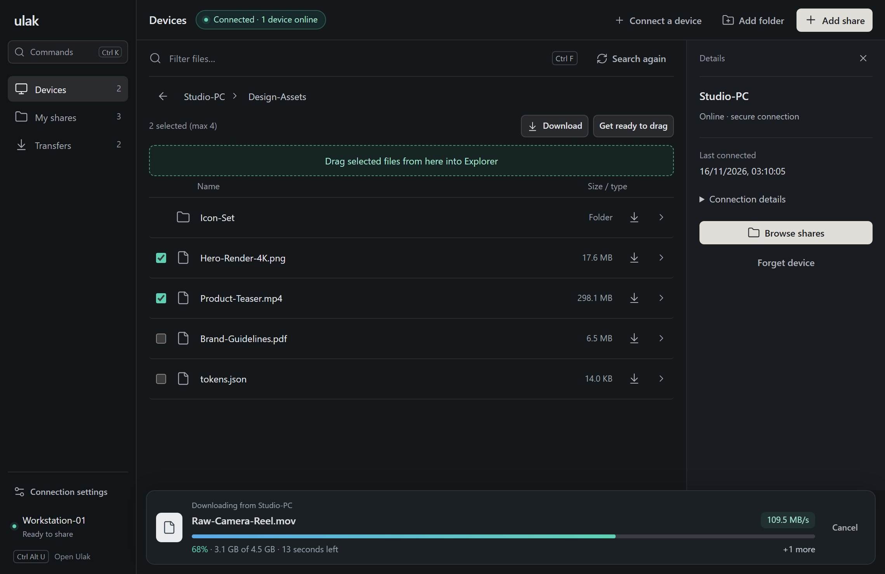
      <br /><sub><b>Remote Browser & Drag Handle</b>: Multi-select remote files, download directly, or drag virtual-file streams into Explorer.</sub>
    </td>
    <td width="50%">
      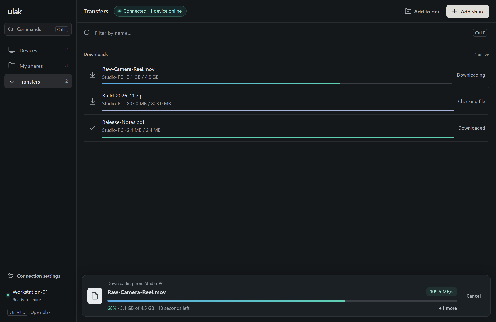
      <br /><sub><b>Transfers</b>: Distinct states for <i>Downloading</i>, <i>Checking file</i> (BLAKE3 verification), and <i>Downloaded</i>, with cancel and resume support.</sub>
    </td>
  </tr>
</table>

---

### 4. Browser Guest Mode & QR Invitations

Need to send files to a phone or a computer without Ulak installed? Generate a single-use QR code or guest link from any share's **Guest invitation** panel. Guests open a self-contained dark web UI served directly from your PC over local HTTPS, with folder navigation, instant filtering, and native browser downloads. Plain-English setup instructions and a **Security code for browser setup** guide manual local CA certificate trust on iOS/Android/desktop browsers when needed.

<table>
  <tr>
    <td width="50%">
      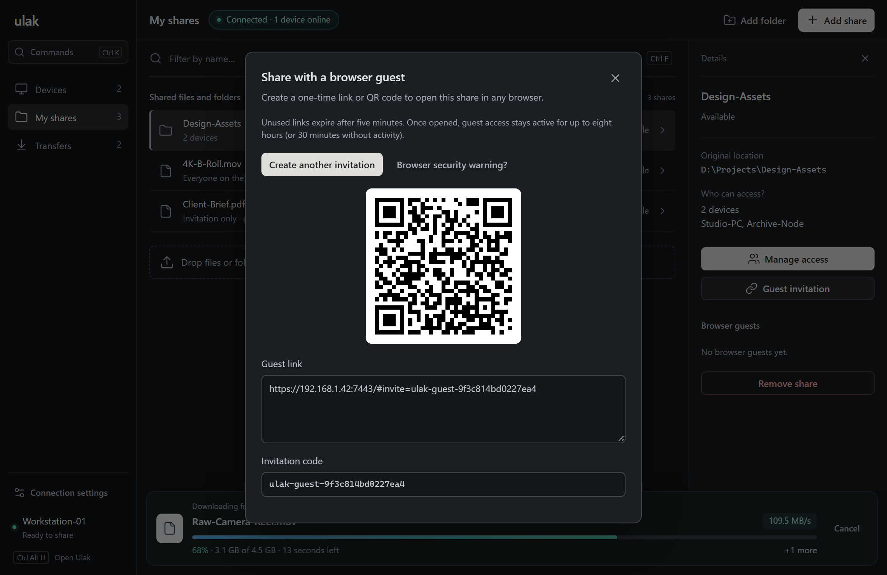
      <br /><sub><b>QR & One-Time Guest Link</b>: Unused links expire in 5 minutes; redeemed sessions stay active up to 8 hours (or 30 minutes idle) and can be revoked anytime.</sub>
    </td>
    <td width="50%">
      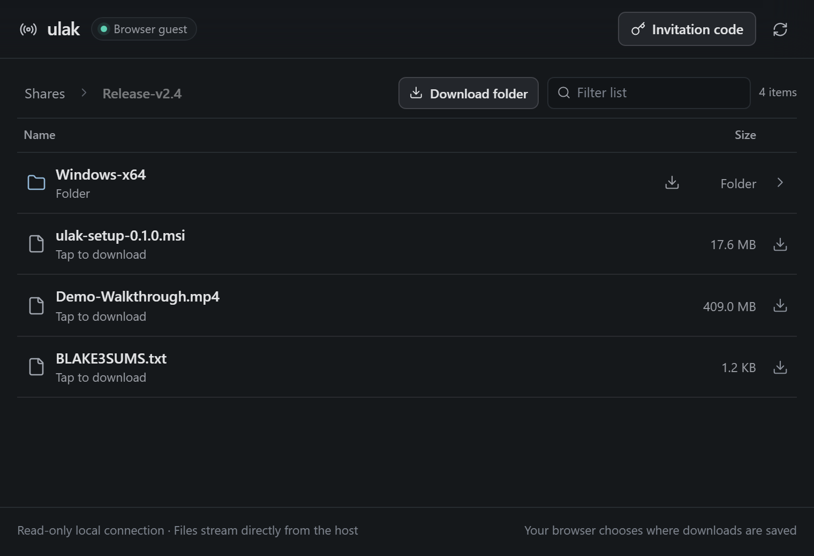
      <br /><sub><b>Offline Guest Web UI</b>: Locally bundled HTML/JS/CSS with zero external network requests.</sub>
    </td>
  </tr>
</table>

---

### 5. Command Menu & Keyboard Access

Navigate the entire desktop without leaving the keyboard. Press `Ctrl+K` to search devices, local shares, and actions in one compact overlay.

<p align="center">
  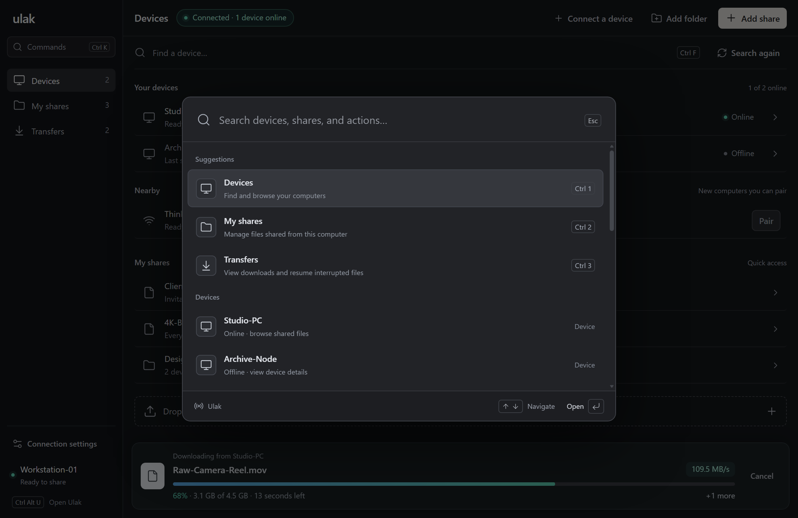
</p>

## Keyboard Shortcuts

| Shortcut | Action |
| --- | --- |
| `Ctrl+Alt+U` | Show, restore, and focus Ulak from any application (while running) |
| `Ctrl+K` | Open the command menu to search devices, shares, and actions |
| `Ctrl+F` | Focus the filter input for the current device, share, or file list |
| `Ctrl+1` / `Ctrl+2` / `Ctrl+3` | Switch between **Devices**, **My shares**, and **Transfers** |
| `Ctrl+,` | Open **Connection settings** |
| `↑` / `↓` / `Home` / `End` / `Enter` | Navigate list rows and open a paired device's shares |
| `Esc` | Clear active filter, dismiss selection, or close open menu/dialog |

---

## Architecture

Ulak separates an authoritative Rust core from the Windows Tauri shell, local CLI, and frontends. File bytes always stream over HTTPS; control messages and frontend snapshots never carry file payloads or secret keys.

```text
ulak/
├── crates/
│   ├── ulak-core/         # Identity (Ed25519/BLAKE3), local CA/TLS, mDNS, pairing, catalog, transfers
│   ├── ulak-local/        # Current-user-only Windows named-pipe IPC & secret-free snapshot codec
│   ├── ulak-cli/          # `ulak` CLI talking to the running desktop over the named pipe
│   ├── ulak-agent/        # Standalone diagnostic CLI (operates when its state dir is unlocked)
│   └── ulak-drag-probe/   # Shared Windows OLE virtual-file COM stream (`IDataObject`/`IStream`) & probe
├── src-tauri/             # Tauri v2 Windows shell, tray lifecycle, native dialogs, IPC host, drag integration
├── src/                   # React 19 + TypeScript + Vite + Tailwind + Zustand desktop UI
├── guest/                 # Bundled offline HTML/JS guest browser & onboarding assets
├── scripts/               # Workspace-contained Rust/npm wrappers, launch helpers, and smoke tests
└── docs/                  # Protocol spec, implementation status, feasibility notes, and screenshots
```

Further documentation:

- [context.md](context.md) - Architecture and UX implementation contract
- [docs/protocol.md](docs/protocol.md) - Identity, pairing handshake, HTTPS API, authorization, and transfer recovery
- [docs/phase-status.md](docs/phase-status.md) - Recorded automated checks vs. pending physical hardware checks
- [docs/feasibility.md](docs/feasibility.md) - Manual verification procedures for mobile HTTPS, Explorer drag-out, and 50 GB transfers

---

## Live Local CLI

The `ulak` product CLI connects to the running desktop over a Windows named pipe keyed by the canonical data directory and current user's SID (with a current-user-only DACL and remote-client rejection). It never opens the desktop's state lock or exposes a LAN/localhost management port.

```powershell
$ulak = '.\target\debug\ulak.exe'

# Inspect running desktop snapshot (shares, peers, transfers, network)
& $ulak status

# Share a file to everyone on the allowed LAN, or a folder to specific paired devices
& $ulak share '.\selected-file.txt' --lan
& $ulak share '.\selected-folder' --device PAIRED_DEVICE_ID

# Browse and pull from a trusted remote descriptor JSON
& $ulak list --remote '.\trusted-connection.json'
& $ulak list --remote '.\trusted-connection.json' --share SHARE_ID
& $ulak download --remote '.\trusted-connection.json' --share SHARE_ID --entry ENTRY_ID --destination '.\downloads'
& $ulak download-folder --remote '.\trusted-connection.json' --share SHARE_ID --destination '.\downloads\folder'

# Manage transfers and shares
& $ulak cancel TRANSFER_ID
& $ulak resume TRANSFER_ID
& $ulak remove SHARE_ID
```

> **Note:** Without `--lan` or `--device`, `ulak share` creates a private (`Invitation only`) share. Export public connection descriptors from **Connection settings → Advanced settings** and deliver them over a trusted channel.

### Standalone Diagnostic Agent (`ulak-agent`)

For headless two-directory testing on one machine (when the server for that state directory is stopped before setup mutations):

```powershell
$agent = '.\target\debug\ulak-agent.exe'

# Host setup and server
& $agent --data .ulak/host share C:\path\to\example.txt --lan-open
& $agent --data .ulak/host descriptor --endpoint https://127.0.0.1:7443/ --output .\host-remote.json
& $agent --data .ulak/host serve --bind 127.0.0.1:7443 --endpoint https://127.0.0.1:7443/ --lan 127.0.0.1/32

# Recipient commands in a second terminal
& $agent --data .ulak/recipient ping --remote .\host-remote.json
& $agent --data .ulak/recipient browse --remote .\host-remote.json --share SHARE_ID
& $agent --data .ulak/recipient download --remote .\host-remote.json SHARE_ID ENTRY_ID .\downloads
```

For real LAN testing with `ulak-agent`, pass the reachable interface to `--bind`, `--endpoint`, `--certificate-ip`, and `--lan` (for example `192.168.1.0/24`), plus `--advertise` for mDNS and `--onboarding ADDRESS:PORT` for the plaintext browser certificate setup page.

---

## Development

### Prerequisites

- Windows 10/11 with WebView2 runtime
- Visual Studio C++ build tools + Windows SDK
- Rust toolchain (or initialize the workspace-contained toolchain via `.\scripts\setup-rust.ps1`)
- Node.js 22.12 or newer

All wrapper scripts keep Cargo caches, Rustup state, npm caches, temporary files, and runtime state (`.ulak/desktop` by default) inside the workspace without modifying global system settings, certificates, or firewall rules.

### Build, Test, and Run

```powershell
# Optional: initialize workspace-local Rust toolchain
.\scripts\setup-rust.ps1

# Install frontend dependencies, build production bundle, and run frontend tests
.\scripts\npm.ps1 ci
.\scripts\npm.ps1 run build
.\scripts\npm.ps1 test

# Build & test the full Rust workspace
.\scripts\cargo.ps1 build --workspace
.\scripts\cargo.ps1 test --workspace
.\scripts\cargo.ps1 clippy --workspace --all-targets '--' -D warnings
.\scripts\cargo.ps1 fmt --all --check

# Build frontend + launch the desktop app
.\scripts\desktop.ps1
```

Once built, you can also launch or focus the existing desktop instance via `Ulak.cmd` (or run `.\scripts\create-shortcut.ps1` to generate a workspace-local `Ulak.lnk`). Closing the window hides Ulak to the system tray while sharing and transfers continue running; use **Quit Ulak** in the tray menu or command menu to stop it.

### Smoke Suites

- `.\scripts\smoke.ps1` - Separate host/recipient `ulak-agent` processes verifying HTTPS identity, LAN-open browsing, and file download comparison.
- `.\scripts\desktop-smoke.ps1` - Launches an isolated WebView desktop instance, tests keyboard navigation, layout bounds, audience changes, guest redemption/replay rejection, CLI downloads, network rollback, close-to-tray continuity, and explicit quit.
- `.\scripts\nearby-smoke.ps1` - Starts two isolated desktop instances to exercise 6-digit numeric comparison, dual approval, rejection, private-share isolation, paired download verification, and global `Ctrl+Alt+U` activation (set `$env:ULAK_TEST_NEARBY_MULTICAST = '1'` to test local-adapter mDNS discovery).

---

## Limits, Guarantees, and Status

### Implemented Bounds & Behavior

- **Concurrency & buffering:** Fixed 64 KiB I/O buffers; at most 4 concurrent served streams, 4 concurrent native downloads, 2 hashing jobs, 64 active HTTP handlers, and 64 queued/running native download jobs.
- **Bounded catalogs & state:** Directory pages return at most 100 immediate children; up to 64 server-side directory cursors expire after 120 seconds of inactivity. State collections and transfer history are capped at 4,096 records with a 32 MiB serialized metadata ceiling.
- **Source & destination safety:** Windows source handles deny concurrent writes and deletion while streaming or hashing. Reparse-point escapes and unsafe Windows filenames are rejected. Native downloads verify complete BLAKE3 digests before non-overwriting finalization.
- **Platform differences:** Browser guest downloads are managed by the browser, and Windows Explorer virtual-file drag-out lets Explorer own destination writing, naming, and cleanup; neither path inherits all native downloader resume/verification guarantees.
- **Deferred from v1:** Clipboard synchronization, automatic folder sync, compression/ZIP archives, guest uploads, dragging whole remote folders into Explorer, native mobile apps, and macOS/Linux agents.

### Validation Scope

Phases 1–4 (feasibility prototypes, trusted core, sharing/downloads, and desktop/CLI integration) are implemented and backed by automated Rust, frontend, and localhost/single-workstation WebView smoke checks. **Physical second-PC and wireless multicast tests, real iOS/Android offline HTTPS certificate setup, interactive Explorer drag-and-drop copies, tray menu mouse checks, native file/folder picker interactions, separate Windows account CLI rejection, disk-exhaustion recovery, independent cryptographic review, and 50 GB sustained-memory acceptance remain open.** See [docs/phase-status.md](docs/phase-status.md) for the exact record of executed checks versus pending hardware validation.

---

## License

[MIT](Cargo.toml)
